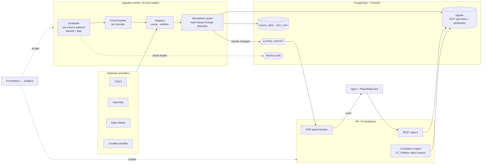

# OverLook

**A geospatial situational-awareness platform that ingests public signals — earthquakes, aircraft, weather, vessels, satellite passes, cameras, infrastructure — normalizes them into one spatial-temporal model, and serves them to a live map.**

[](https://github.com/vbhvx/OverLook/actions/workflows/ci.yml)

It is built the way a production data platform is built: durable PostGIS storage behind a tested storage contract, a horizontally scalable stateless API, a leader-elected ingestion worker with per-provider circuit breakers, real-time push to browsers, and metrics, alerts and dashboards out of the box.

| | |
|---|---|
| **Live integrations** | USGS earthquakes · OpenSky aircraft state vectors · Open-Meteo observations & forecasts |
| **Curated samples** | AIS vessels · Copernicus footprints · DOT cameras · OSM infrastructure — labelled `simulated`, never presented as live |
| **Stack** | FastAPI · asyncio · PostgreSQL 16 + PostGIS 3.4 · Alembic · React 18 · TypeScript · MapLibre GL · nginx · Prometheus · Grafana |
| **Quality gates** | 145 backend tests (the storage contract runs against both engines) · 94% coverage · ruff · ESLint · tsc · CI with a live PostGIS service and a full-stack smoke test |

---

## Architecture



**Write path.** The worker polls each provider on its own cadence (set from that provider's published rate limits). A sync goes: circuit check → fetch under a hard timeout → validate (future-dated "observations" and naive timestamps are rejected; forecasts may be in the future) → upsert keyed on signal ID with SHA-256 payload hashes deciding *insert / update / unchanged*. Revisions keep their original `ingestedAt`; unchanged records only bump `lastSeenAt`. Health and run history are persisted so every API replica reports the worker's view.

**Read path.** API replicas hold no state. Viewport queries use `ST_Intersects` on a GiST-indexed geometry column (antimeridian-crossing boxes are split in two); "what's near this signal" uses `ST_DWithin` on a geography column for metre-accurate radius search; the timeline uses `date_bin` aggregation with interval-aligned bucket edges.

**Real-time path.** When a sync changes data, the worker issues `pg_notify`. Every API replica `LISTEN`s and fans the event out to its connected browsers over Server-Sent Events. The UI refreshes on push and only falls back to polling while the stream is down — no message broker needed.

## Engineering highlights

- **Two storage engines, one contract.** `SignalStore` has an in-memory and a PostGIS implementation. A single 17-case contract suite (`test_store_contract.py`) runs against both — including antimeridian bboxes, pagination stability, timeline bucketing, retention and ingestion-time preservation — which is what keeps them interchangeable. Dev and unit tests need no database; CI proves parity.
- **Exactly-once ingestion across replicas.** Run as many workers as you like: a session-level Postgres advisory lock elects one leader. If it crashes, Postgres drops the session and the lock, and a standby takes over on its next poll. No lease timers, no ZooKeeper. Tested, including the crash case.
- **Failure containment.** Each provider has its own circuit breaker (closed → open → half-open), exponential backoff with equal jitter, and a fetch timeout. One provider timing out or rate-limiting never delays another. A rate-limited provider is a *failed* run — the adapter's cached payload is not re-ingested as if it were fresh.
- **Data honesty is tested.** The spec forbids presenting manufactured data as real. Sources without a live integration are registered `simulated`, and a test asserts every record they emit is labelled `isSimulated` / `dataStatus=simulated`. Correlations are versioned rules with measured distance and time delta on every relation, and confidence never exceeds `observational_association`.
- **Operational surface.** JSON logs with a request ID that is propagated, echoed in `X-Request-ID`, and returned in every error body. Prometheus metrics labelled by route *template* (bounded cardinality). Liveness vs readiness probes (readiness checks the schema, not just the socket). Alert rules for error ratio, p95 latency, open circuits and "no ingestion leader".
- **Hardening.** Strict CORS (production refuses `*`), per-client token-bucket rate limiting that trusts `X-Forwarded-For` only up to the configured proxy depth, per-source cooldown on manual sync, security headers + CSP at nginx, validation errors that never reflect input back, non-root containers, bounded SSE fan-out with drop-oldest backpressure.
- **Frontend correctness.** In-flight requests are aborted when filters change so stale responses can't overwrite fresh ones; viewport queries are debounced; parallel loads; push-driven refresh; vendor chunks split so deploys don't bust the MapLibre cache.

Design decisions and their trade-offs are recorded in [`docs/adr/`](docs/adr).

## Run it

### Full stack (Docker)

```bash
cp .env.example .env
docker compose up --build              # UI → http://localhost:8080
docker compose --profile observability up --build   # + Prometheus :9090, Grafana :3001
docker compose up --scale worker=2     # second worker stands by on the leader lock
```

Compose starts PostGIS, runs migrations as a one-shot job, then the API, the worker and the web tier, each gated on the previous one's health.

### Local development (no database)

```bash
make install
make api      # FastAPI on :8000 with the in-memory store and embedded scheduler
make web      # Vite on :5173, proxying /api
```

With `DATABASE_URL=memory://` (the default) the API runs its own scheduler in-process; set a PostGIS URL to use durable storage and the standalone worker (`make worker`).

### Tests

```bash
make test        # backend (memory store) + frontend
make up && make test-pg   # adds the PostGIS contract suite and coordination tests
make lint
```

## Repository layout

```
backend/app/
  api/            HTTP layer: v1 routers, dependency wiring, error envelope
  core/           logging, metrics, middleware, resilience, event bus
  storage/        SignalStore contract + memory and PostGIS implementations
  ingestion/      registry, pipeline service, scheduler, leader election
  correlation/    rule-based spatial-temporal correlation
  providers/      one adapter per upstream source
  container.py    composition root shared by API and worker
  worker.py       standalone ingestion process
backend/migrations/   Alembic (hand-written SQL: PostGIS types, partial & GiST indexes)
frontend/src/     React + MapLibre UI: api/ client, hooks/ state, lib/ pure logic, components/ views
deploy/           Prometheus scrape config + alert rules, Grafana dashboard
docs/             architecture, frontend, API, data model, sources, deployment, ADRs
```

## Limitations

- Four of seven categories are curated samples pending licensed or catalog integrations (see [`docs/sources.md`](docs/sources.md)).
- Rate limiting is per replica; a global limit belongs at the edge or in Redis behind the same interface.
- Correlation rules are deliberately simple and transparent; they surface co-occurrence, not causation.

Data attribution: USGS (public domain), OpenSky Network, Open-Meteo (CC BY 4.0), © OpenStreetMap contributors (ODbL), Copernicus Sentinel data.
